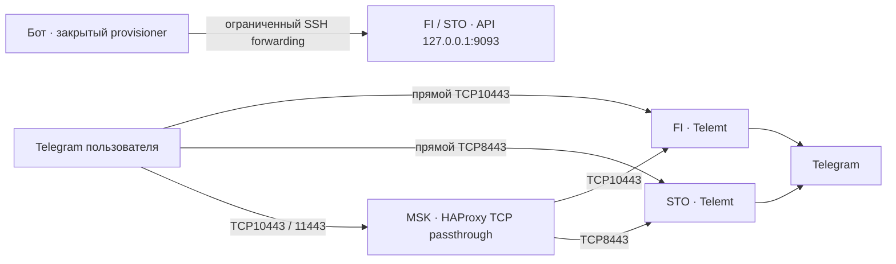

# Telegram в Otvali: четыре персональных MTProto-маршрута

Дата: 30 октября 2026. Статус: реализация подготовлена и проверена локально; **production-развёртывание и приёмка подключений ещё не подтверждены**. Этот документ описывает согласованный выпуск, а не отчёт о работающем production.

## Границы выпуска

Бот и Mini App получают раздел «Прокси для Telegram» с четырьмя маршрутами. Для каждого пользователя и маршрута выдаётся собственная стабильная MTProto FakeTLS-ссылка. Повторное получение сохраняет тот же доступ. VPN-подписка остаётся одной; менять существующие пользовательские VPN-конфиги не требуется.

В этом выпуске реализован MTProto. Управляемая выдача SOCKS5 отложена; существующий legacy SOCKS5 сохраняется без изменений. Наличие SOCKS5 в исследовании не означает, что бот уже умеет его выдавать.

FakeTLS снижает некоторые различия с обычным TLS, но не гарантирует обход блокировки IP, домена, порта или провайдера. Московские входы дают другой путь к зарубежным узлам; их доступность проверяется отдельно от прямых подключений.

## Согласованная топология

| ID маршрута | Вход пользователя | Выход к Telegram |
|---|---|---|
| `finland` | FI TCP10443 | Новый Telemt на FI |
| `stockholm` | STO TCP8443 | Новый Telemt на STO |
| `msk-finland` | MSK TCP10443 → FI TCP10443 | Тот же новый Telemt на FI |
| `msk-stockholm` | MSK TCP11443 → STO TCP8443 | Тот же новый Telemt на STO |

- FI TCP8443 со старым Telemt, legacy SOCKS5 и все действующие VPN-входы остаются без изменений. Новый FI listener использует **10443**, не переиспользует 8443.
- MSK работает как TCP passthrough: не завершает FakeTLS, не выдаёт отдельные credentials и не направляет Telegram через Remnawave.
- На каждом зарубежном узле прямой и московский маршруты используют разные персональные grants, хотя обращаются к одному Telemt API.
- Новые процессы не занимают существующие TCP443, FI9443 и порты Remnawave. Перед запуском нужны проверки занятости портов, firewall IPv4/IPv6 и регрессии существующих сервисов.
- Новые management API доступны только на loopback. Публичный сайт не содержит management-адресов, credentials или метрик.

Версии закреплены digest, а не плавающим `latest`:

- Telemt **3.5.14**, source commit `9d5b896bb695c55e2905b82f276da84e45a0a2ec`; OCI index `ghcr.io/telemt/telemt@sha256:b311c20596213a3941dcd11f499be982de74f554eecfffe57fab51c1bf80d50a`.
- HAProxy **3.2.26**; OCI index `docker.io/library/haproxy@sha256:b26dc654dcd188970e4ba3d478fd92b5b00688f85a81f0a50b1adc63bd3e0793`.
- Экспериментальный WEB transport Telemt в выпуск не входит. API нового экземпляра нельзя путать с API старого FI Telemt 3.5.5.

## Выдача и хранение доступа

`internal/telegramproxy` отделён от выдачи VLESS. Каталог содержит только ID, название, протокол и признак основного маршрута. Доступ проверяется по связанному numeric Telegram ID и настроенной аудитории; изменяемый username не является идентификатором владельца.

В PostgreSQL сохраняется grant: пользователь, Telegram ID, маршрут, provider, opaque external ID, binding hash, generation, состояние и зашифрованный secret. Состояния: `pending`, `active`, `revoking`, `revoked`. Секрет шифруется AES-GCM; 32-байтовый ключ и служебные credentials хранятся через OpenBao и передаются закрытой конфигурацией. Plaintext-ссылки не сохраняются в событиях или логах.

Последовательность выдачи:

1. Проверить привязку аккаунта, аудиторию и отсутствие tombstone отзыва.
2. До внешнего запроса сохранить pending grant и его случайный secret. Повторная операция использует тот же desired secret.
3. Под блокировкой строки сверить Telemt и применить недостающее состояние с `If-Match`. При потерянном ответе сначала читать и сверять, не создавать новый secret вслепую.
4. Подтвердить состояние, выполнить CAS по generation и повторно проверить право выдачи перед возвратом ссылки. Завершившаяся поздно выдача не должна обойти отзыв.
5. Вернуть только персональный `https://t.me/proxy?...` с проверенными параметрами. Сама ссылка является секретом доступа.

Бот не получает root SSH или Docker socket. Для API используется выделенный ограниченный SSH-аккаунт с фиксированным разрешённым forwarding к `127.0.0.1:9093`, закреплённым host key и без произвольных удалённых команд. Telemt дополнительно проверяет точное значение `Authorization`; API не публикуется наружу.

## Отзыв и важные особенности Telemt

Админская команда `/revoke_telegram <user_id> [route|all]` показывает подтверждение и отзывает один или все четыре маршрута. Это внутренний ID пользователя из `/users`, не username. Tombstone сохраняется и после удаления строки пользователя; повторное нажатие не восстанавливает доступ. Удаление пользователя блокируется, пока отзыв его proxy grants не подтверждён.

- Перед remote disable фиксируется состояние `revoking`. Только подтверждённый `POST /v1/users/{name}/disable` позволяет завершить отзыв.
- `GET enabled=false` или `404` **не считаются успешным отзывом**: чтение disk-first не доказывает прекращение действующих соединений. Неопределённый результат остаётся незавершённым для сверки.
- Telemt после успешного сохранения disable устанавливает запрет admission и сигналит отмену текущих сессий пользователя до ответа API. Закрытие сокетов происходит асинхронно. У остальных пользователей доступ сохраняется.
- Ответ `202` пользовательского API содержит обычный user payload, **не reload ID**. Поле `in_runtime` означает только наличие username в runtime; оно не подтверждает совпадение enabled/secret.
- GET пользователя не имеет отдельного поля `secret`, но содержит его внутри `links.tls[]`; весь ответ чувствительный. `general.links.show=[]` подавляет startup-печать ссылок и не отключает их в закрытом API.
- Не запускать глобальный reload ради каждой выдачи. Поведение watcher и реальные новые/отозванные credentials проверяются при приёмке.

## UX бота и Mini App

В боте `/telegram` и пункт «Прокси для Telegram» открывают список четырёх маршрутов без выдачи секретов. Выбор маршрута подготавливает доступ и показывает **«Подключить в Telegram»**. Пользователь подтверждает подключение средствами Telegram; бот не включает прокси за него.

Текст результата говорит «Прокси подготовлен», а не «Подключено». Он напоминает не передавать ссылку, предлагает другой маршрут и оставляет проверку соединения настройкам Telegram. Ошибки выдаются коротко, без provider URL, secret или raw response. Если ссылка уже получена, временный сбой API не повод удалять её.

Mini App использует те же четыре маршрута и явное действие получения ссылки:

- `POST /api/miniapp/telegram/proxies` — метаданные без credentials;
- `POST /api/miniapp/telegram/proxy` с `{"id":"finland"}` — только собственный credential;
- действуют проверка initData, numeric actor, связанный аккаунт, origin/rate limits и `Cache-Control: no-store`;
- credential не попадает в query своего сайта, localStorage, аналитику или публичный cache.

Proxy-ссылка не обновляется как VPN-подписка. При обычном повторном получении она стабильна; смена secret/SNI/endpoint потребует отдельной миграции. Резервный маршрут пользователь добавляет явно. Для сообщений и медиа предназначен MTProto; **для звонков следует использовать VPN**, пока конкретный клиентский путь не прошёл отдельную проверку.

Общее упрощение навигации бота и приложения ведётся в отдельном чате «Otvali: упростить бот и Mini App». Этот выпуск не меняет утверждённую кампанию приглашений и не отправляет новую рассылку.

## Наблюдаемость: что действительно записывается

Реализованы `telegram_proxy_delivered` после успешной доставки ботом ответа со ссылкой и `miniapp_telegram_proxy_response` после ответа Mini App. Это события выдачи доступа, **не подключения или использования Telegram**.

URL-кнопка Telegram не присылает callback о нажатии. Сбор реальных proxy connections/traffic и соответствующие уведомления в этом выпуске не реализованы. Нельзя показывать «подключился к маршруту» на основании выдачи ссылки. Если такая телеметрия появится позже, она должна быть административной, без содержимого сообщений, destination IP и credentials; автоматические проверки клиента тоже создают соединения.

## Приёмка перед включением

Локальные проверки покрывают авторизацию, стабильность выдачи, конкурирующий отзыв, ошибки API, ограниченные SSH targets, URL validation и отсутствие credentials в ответах об ошибке. Успешный локальный тест не подтверждает доступность из России.

До production acceptance необходимо:

1. Зафиксировать исходное состояние старых VPN/Telegram listeners и rollback; сверить pinned image, закрытость API/метрик и новые firewall-правила.
2. С домашней машины проверить все четыре маршрута: FakeTLS/MTProto handshake и настоящий ответ Telegram, повторные соединения, ошибочный secret и сохранность действующих VPN-конфигов. TCP connect и зелёный контейнер недостаточны.
3. Проверить индивидуальный disable: новые подключения отклоняются, активные завершаются, соседний grant продолжает работать. Потерянный ответ API не создаёт новый secret и не считается успешным отзывом.
4. Пройти бот и Mini App настоящими аккаунтами: четыре персональные ссылки, повторная выдача без смены ссылки, доступ только владельцу, админское подтверждение отзыва, отсутствие ложного «подключён».
5. Зафиксировать версии Android/iOS/Desktop и результаты Wi-Fi/мобильной сети: сообщения, загрузка/отправка файлов, возврат из фона и смена сети. Звонки проверять отдельно; неизвестное не объявлять успешным.

Оператор добавляет фактические результаты развёртывания отдельно. До этих проверок функция не считается принятой в production.

## Отложенный SOCKS5 и источники

Для будущей управляемой выдачи SOCKS5 нужны отдельные персональные credentials и проверяемый egress ACL. Plain SOCKS5 не маскирует транспорт, а [RFC1929](https://www.rfc-editor.org/rfc/rfc1929.html) передаёт его пароль без собственного шифрования; это не означает plaintext-содержимое Telegram. Поддержку звонков нельзя обещать лишь из-за наличия UDPASSOC. Legacy SOCKS5 не изменяется этим выпуском.

- [Telemt API и конфигурация на закреплённом commit](https://github.com/telemt/telemt/blob/9d5b896bb695c55e2905b82f276da84e45a0a2ec/docs/Architecture/API/API.md).
- [User admission: немедленный disable и отмена сессий](https://github.com/telemt/telemt/blob/9d5b896bb695c55e2905b82f276da84e45a0a2ec/src/proxy/user_admission.rs#L305).
- [Telegram proxy links](https://core.telegram.org/api/links#proxy-links) и [настройка proxy в клиентах](https://core.telegram.org/proxy).
- [mtg: ограничения размещения и маскировки](https://github.com/9seconds/mtg/blob/v2.2.8/BEST_PRACTICES.md); [Telegram Desktop: ограничения звонков через proxy](https://github.com/telegramdesktop/tdesktop/issues/23916).
